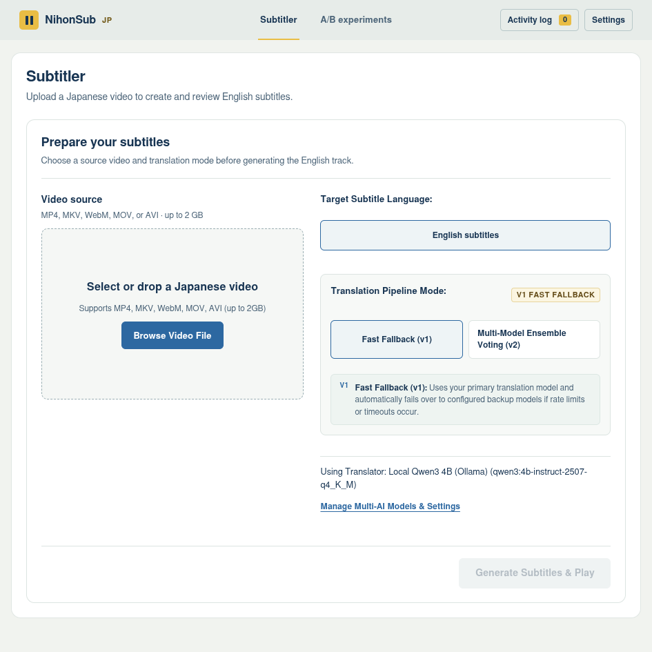
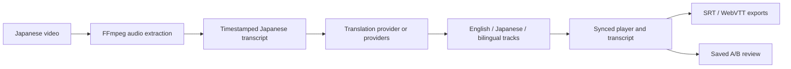

<div align="center">

# NihonSub <sub>日本サブ</sub>

### Japanese dialogue, translated and timed for the picture.

**A local-first workspace for creating, reviewing, and comparing Japanese-to-English subtitles.**

[Quick start](#quick-start) · [Workflow](#the-workflow) · [Project map](#project-map) · [Origin](#project-origin)

<br>



*The subtitler setup screen, captured from the running app.*

</div>

---

## What this project is

NihonSub turns a Japanese video into timestamped English subtitles, then gives you a way to check those words against the scene. It is designed for a focused loop: **transcribe → translate → watch → refine**.

This is a personal, evolving project—not an official upstream release or a claim of affiliation with the original maintainers. The codebase began as a fork and has since grown around its own subtitle-review workflow, including saved A/B experiments.

## The workflow

| 01 · Prepare | 02 · Generate | 03 · Review |
| --- | --- | --- |
| Choose a Japanese video (MP4, MKV, WebM, MOV, or AVI; up to 2 GB). | Create timestamped Japanese speech with local Parakeet by default; translate with local Qwen through Ollama by default. | Watch with synchronized captions, search and follow the transcript, adjust timing, and export `.srt` or `.vtt`. |

### Make subtitle choices visible

- **Japanese source transcript + English translation.** Switch between English, Japanese, and bilingual subtitle tracks.
- **Translation providers you control.** Use local Ollama or configure compatible translation providers in Settings. Choose fast fallback or multi-model ensemble mode when multiple providers are configured.
- **Review against the video.** The player keeps captions, transcript cues, and playback time together. Search transcript text, jump to a cue, adjust subtitle offset, and choose a caption style.
- **Compare saved experiments.** Review baseline (A) and candidate (B) outputs over the same video, inspect aligned cues, and compare an embedded reference subtitle track when available. Comparisons show differences; they do not claim that a candidate is objectively better.
- **Keep the outputs.** Export SubRip (`.srt`) and WebVTT (`.vtt`) subtitle files.

## Quick start

### 1. Install the basics

- **Node.js 18 or newer**.
- **FFmpeg + FFprobe**. Install with your platform's package manager:
  - macOS: `brew install ffmpeg`
  - Ubuntu / Debian: `sudo apt install ffmpeg`
  - Windows: `scoop install ffmpeg` (or `choco install ffmpeg`)
- **Ollama** with the default local translation model, if you want local translation:

  ```bash
  ollama pull qwen3:4b-instruct-2507-q4_K_M
  ```

- **Local transcription:** the default Parakeet worker needs `uv`, Python 3.12, PyTorch, and NeMo; install it in step 3 below. Skip this if you configure another transcription provider.

### 2. Install NihonSub

```bash
git clone https://github.com/tonywonguf/NihonSub.git
cd NihonSub
npm install
cp .env.example .env
```

### 3. Install local Parakeet transcription

Run this for the default local transcription setup. The script creates a project virtual environment and installs Python 3.12, CPU PyTorch, and NVIDIA NeMo. The first model use downloads model files.

```bash
./setup-parakeet.sh
```

To use another OpenAI-compatible transcription service instead, configure its endpoint, model, and key through the environment or Settings.

### 4. Start the app

```bash
npm start
```

Open **http://localhost:3000**. Upload a short Japanese clip, choose a translation mode, and generate subtitles. The default configuration uses local Parakeet transcription and local Ollama translation; cloud credentials are optional when you configure a cloud provider in Settings.

## Keyboard shortcuts

| Key | Action |
| --- | --- |
| <kbd>Space</kbd> | Play / pause |
| <kbd>←</kbd> / <kbd>→</kbd> | Seek 5 seconds |
| <kbd>↑</kbd> / <kbd>↓</kbd> | Adjust volume |
| <kbd>F</kbd> | Toggle fullscreen |
| <kbd>C</kbd> | Toggle subtitles |

## How it fits together



### Project map

- `server.js` — local Express app, upload and processing endpoints, and run APIs.
- `audioExtractor.js`, `transcriber.js`, `parakeet_transcribe.py` — audio preparation and transcription.
- `translator.js`, `subtitleGenerator.js` — provider-driven translation and subtitle output.
- `runStore.js`, `referenceSubtitles.js` — saved runs and embedded reference subtitle support.
- `public/` — browser UI, synchronized player, transcript, and A/B review.
- `test/` — Node.js tests (`npm test`).

## Development

```bash
npm test
```

The server binds to `127.0.0.1` and is intended for local use. Uploaded videos, generated audio, subtitles, and saved runs live under `storage/`; review `.gitignore` before adding any media or run data to version control.

## Project origin and license

NihonSub began as a fork of [Abhishantpadam/NihonSub](https://github.com/Abhishantpadam/NihonSub). This repository is maintained independently; upstream changes and this project's direction may differ. The upstream project is credited here for provenance, not as an endorsement or affiliation.

There is currently no `LICENSE` file in this repository or in the tracked upstream tree. The upstream README describes its project as MIT-licensed, but that statement is not a substitute for checking the source's license and history. **Do not assume a license from this README.** Verify what rights apply before redistributing inherited code, and add a license only after confirming them.
